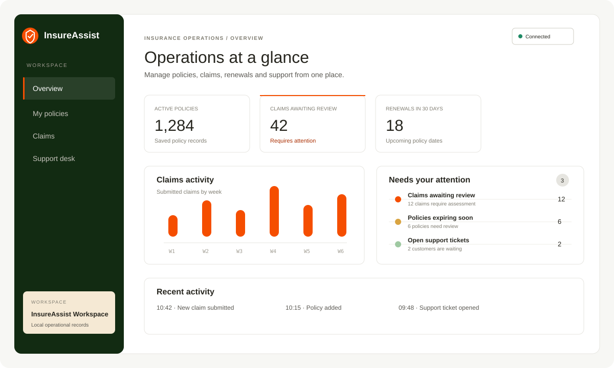
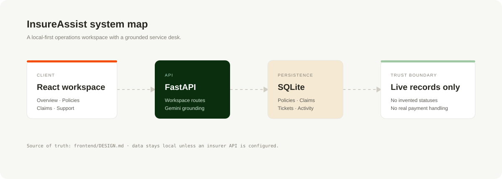

# InsureAssist

<p align="center"><strong>A calm, local-first insurance operations workspace.</strong><br/>Policies, claims, renewals and support records in one practical interface.</p>

<p align="center"></p>

<p align="center"><sub>Conceptual product illustration for the README; the running application renders only records from its local database.</sub></p>

InsureAssist is a standalone insurance operations product built for clarity at the point of work. It helps a team keep policy records, claim progress, renewal dates and support tickets together without pretending that local records are connected to a carrier system.

## Product principles

- Operational before ornamental: every panel should answer “what needs attention?”
- Live records only: the interface does not invent claim statuses, coverage, payments or percentages.
- Local by default: SQLite stores the workspace on the installation.
- Grounded assistance: Gemini can explain the current records, but it is not the system of record.
- Integration-ready: insurer, payment and document APIs are explicit future boundaries.
- Premium restraint: warm editorial canvas, ink typography, hairlines and one controlled accent.

## For coding agents

This section is the short project brief an implementation agent should read before changing the code.

### What this project is

InsureAssist is a single-workspace insurance operations UI. It is not connected to UAI or another product, and it has no login flow. The workspace is created automatically and has one local data boundary.

### Source-of-truth files

| Area | File | Responsibility |
| --- | --- | --- |
| API | `app.py` | FastAPI routes, Gemini grounding and request models |
| Persistence | `db.py` | SQLite schema, workspace records and overview calculations |
| App shell | `frontend/src/App.jsx` | Tab selection, workspace lifecycle, modal lifecycle |
| Design source | `frontend/DESIGN.md` | Mandatory visual tokens and interaction rules |
| API client | `frontend/src/lib/api.js` | Browser-to-FastAPI requests |
| Shared UI | `frontend/src/components/` | Layout, primitives and visual components |
| Features | `frontend/src/features/` | Overview, policies, claims, support and record forms |

### Non-negotiable constraints

- Do not reintroduce login, registration, UAI links or another product’s identity.
- Do not hardcode customer, policy, claim or ticket records into the frontend.
- Do not display invented statistics as real data. Empty states must remain honest.
- Read `frontend/DESIGN.md` before changing visual styling.
- Keep the UI operational and premium; avoid generic AI gradients, glowing orbs and decorative copy.
- Keep insurer, payment and document integrations behind explicit API boundaries.
- Use the existing SQLite workspace unless a migration is intentionally designed.

## System map

<p align="center"></p>

### Data flow

```text
React + Vite
    ↓ /api
FastAPI
    ├── workspace dashboard calculations
    ├── policy, claim and ticket CRUD
    └── grounded Gemini explanation layer
    ↓
SQLite
    ├── customers/workspace
    ├── policies
    ├── claims
    ├── tickets
    └── activities
```

## Features

### Overview

The Overview page is an operational brief, not a greeting screen. It shows:

- Active policies
- Claims awaiting review
- Renewals within 30 days
- Open support tickets
- Claims activity by week
- Claims grouped by status
- Action-required queue
- Recent activity

Every value is calculated from the local database. When there is no data, the page explains what will appear after records are added.

### My policies

Create and review policy records with:

- Policy number
- Type and plan
- Status
- Sum insured
- Premium
- Renewal date
- Coverage and exclusions

### Claims

Create and review claim records with:

- Claim number
- Claim type and amount
- Submission date
- Status
- Next action
- Assigned team

### Support desk

- Ask about current workspace records through Gemini
- Keep conversation context in the active session
- Create human-support tickets
- Display ticket priority and status

## Run locally

### Backend

```powershell
cd C:\Users\athar\Desktop\Siddhi\InsureAssist
python -m venv .venv
.\.venv\Scripts\Activate.ps1
pip install -r requirements.txt
Copy-Item .env.example .env
uvicorn app:app --reload
```

### React development server

Open a second terminal:

```powershell
cd C:\Users\athar\Desktop\Siddhi\InsureAssist\frontend
npm install
npm run dev
```

Vite proxies `/api` to `http://127.0.0.1:8000`.

### Production bundle

```powershell
cd C:\Users\athar\Desktop\Siddhi\InsureAssist\frontend
npm run build
```

FastAPI serves `frontend/dist` automatically when the production bundle exists.

## Environment

```env
GEMINI_API_KEY=your_gemini_key
GEMINI_MODEL=gemini-2.0-flash
INSUREASSIST_DB=./insureassist.db
INSUREASSIST_WORKSPACE_ID=local-workspace
INSUREASSIST_WORKSPACE_NAME=InsureAssist Workspace
```

Gemini is optional. Without a key, the product remains usable in data-driven mode and refuses to fabricate missing records.

## API surface

| Method | Endpoint | Purpose |
| --- | --- | --- |
| GET | `/api/health` | Database and Gemini status |
| GET | `/api/dashboard` | Workspace records plus Overview analytics |
| GET/POST | `/api/policies` | List or add policy records |
| GET/POST | `/api/claims` | List or add claims |
| GET/POST | `/api/tickets` | List or add support tickets |
| POST | `/api/chat` | Answer from current workspace records |

## Frontend structure

```text
frontend/src/
├── App.jsx
├── components/
│   ├── brand/               # BrandLogo and LogoMark
│   ├── layout/              # Sidebar and Topbar
│   ├── ui/                  # Shared visual primitives
│   └── reactbits.jsx        # Motion primitives used sparingly
├── features/
│   ├── overview/            # Operational overview and analytics
│   ├── policies/            # Policy records
│   ├── claims/              # Claim records
│   ├── support/             # Service desk and tickets
│   └── records/             # Shared record modal
├── hooks/                   # Workspace fetching and toast state
└── lib/                     # API client and constants
```

Feature pages own domain behavior. Shared components stay presentation-focused. `db.py` owns persistence and Overview calculations; the browser never owns the source of truth.

## Design direction

The definitive design rules live in [`frontend/DESIGN.md`](frontend/DESIGN.md). In short: warm cream canvas, near-black ink, Cursor Orange reserved for primary actions, hairline-only depth, restrained radii, and 400-weight editorial display type. The visual system should feel like a careful operations product—not an AI demo.

## Validation

```powershell
cd C:\Users\athar\Desktop\Siddhi\InsureAssist\frontend
npm run format:check
npm run build

cd ..
python -m pytest -q
```

## Responsible boundaries

This is an operations workspace and decision-support interface. It does not make final underwriting or claim decisions, does not process payments, and does not handle real customer secrets. Connect official insurer and payment APIs only after their authentication, audit, privacy and compliance requirements are defined.

## Project assets

- Loading illustration: [`frontend/public/insureassist-loading.png`](frontend/public/insureassist-loading.png)
- Product overview: [`docs/insureassist-overview.svg`](docs/insureassist-overview.svg)
- System map: [`docs/insureassist-architecture.svg`](docs/insureassist-architecture.svg)
